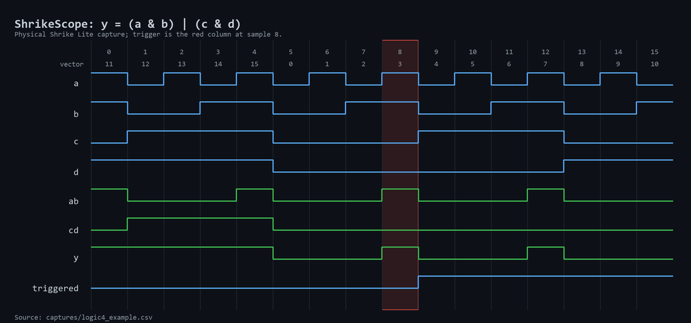
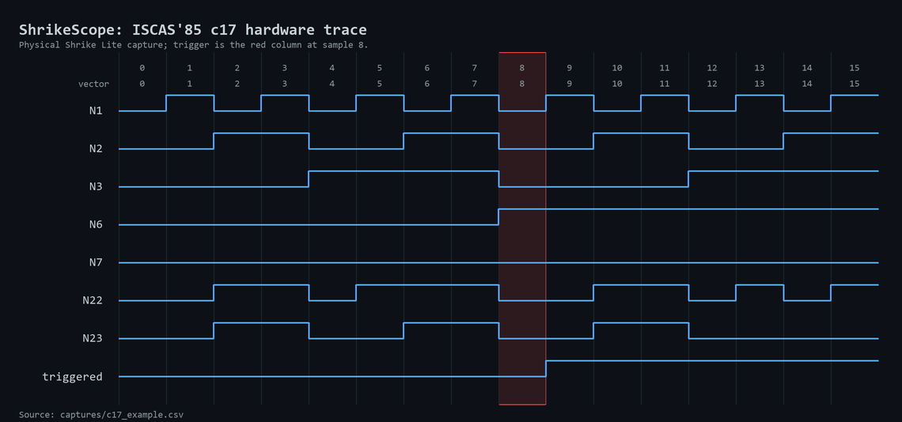
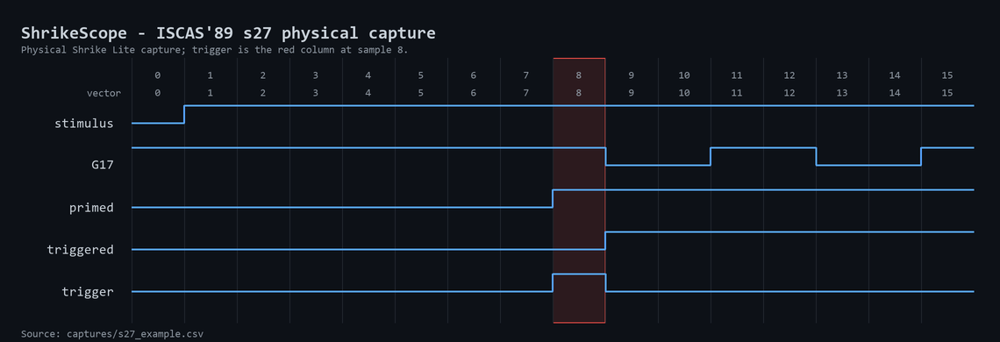

# shrike-traces

shrike-traces is a small digital logic analyzer for Shrike Lite. It records
signals inside your FPGA design, triggers on a condition, and saves a 16-sample
trace as CSV and VCD files.

This is an internal FPGA signal analyzer. It does not measure an external analog
voltage like an oscilloscope.

## Windows setup

You need:

- Windows 10 or 11
- Python 3.10 or newer
- Git
- [Renesas Go Configure Software Hub](https://github.com/vicharak-in/shrike/blob/main/docs/tools_setup_guide.md)
- Shrike Lite with RP2040 and the
  [MicroPython firmware](https://github.com/vicharak-in/shrike/blob/main/docs/getting_started.md)
- GTKWave for Windows (optional)

Clone and set up the repository from PowerShell:

```powershell
git clone https://github.com/Deagle2/shrike-traces.git
cd shrike-traces
py trace.py setup
```

Setup fetches the pinned `shrike-gen` dependency, creates `.venv`, installs the
Python packages, and checks the Windows FPGA tools. Check it again at any time with:

```powershell
.\.venv\Scripts\python trace.py doctor
```

Go Configure is detected automatically in its normal installation folder. If
you installed it elsewhere, run:

```powershell
py trace.py setup --toolchain "D:\path\to\Go Configure Software Hub"
```

## First capture

Connect one Shrike Lite by USB and run:

```powershell
.\.venv\Scripts\python trace.py examples\up_down_counter\trace.json
```

This one command generates the wrapper, builds the FPGA image with the Windows
Renesas tools, programs the board, captures the samples, and opens GTKWave.

The example records `count`, `up_down`, and `reset`. It triggers when
`count == 17`. CSV and VCD files are saved in `captures\`.

If several serial devices are connected, `doctor` lists them. Select the board
with its current port:

```powershell
.\.venv\Scripts\python trace.py examples\up_down_counter\trace.json --port COM3
```

Use `--no-view` to save without opening GTKWave. To open a saved trace manually,
include the `captures` folder:

```powershell
gtkwave .\captures\capture_name.vcd
```

## Try your own RTL

Create a folder such as `examples\my_design\`. Put one Verilog module and one
`trace.json` file inside it. For an 8-bit up/down counter:

```json
{
  "design": "up_down_counter.v",
  "top": "up_down_counter",
  "clock": "clk",
  "reset": { "signal": "reset", "active": 1 },
  "probes": ["count", "up_down", "reset"],
  "trigger": "count == 17",
  "stimulus": {
    "up_down": { "sequence": [1, 0], "cycles_per_value": 32 }
  }
}
```

Generate the wrapper without building:

```powershell
.\.venv\Scripts\python trace.py examples\my_design\trace.json --prepare-only
```

Build without programming the board:

```powershell
.\.venv\Scripts\python trace.py examples\my_design\trace.json --build-only
```

Remove `--build-only` for the complete build, flash, capture, and view flow.

The automatic flow currently accepts:

- one self-contained module with ANSI-style ports
- combinational logic or one positive-edge clock domain
- up to 16 total probe bits
- up to 16 non-clock stimulus input bits
- one 16-sample capture window
- comparisons using `==`, `!=`, `<`, `<=`, `>`, or `>=`, joined with `&&` or
  `||`

Parameters, multiple source modules, multiple clocks, inferred latches,
arithmetic trigger expressions, and wider automatic probes need direct RTL
integration with the analyzer in `ffpga/src/`. Changing a trigger creates a new
FPGA image.

The four-bit multiplier is another starter example:

```powershell
.\.venv\Scripts\python trace.py examples\multiplier\trace.json
```

It triggers when `a == 6 && b == 7`; the product at that sample is 42.

## Import the vendor PWM example

shrike-traces can instrument the unchanged `pwm_4ch` example from the Vicharak
Shrike repository. Starting in a folder that contains `shrike-traces`:

```powershell
git -c core.protectNTFS=false clone --filter=blob:none --sparse https://github.com/vicharak-in/shrike.git
cd shrike
git -c core.protectNTFS=false sparse-checkout set examples/pwm_4ch
cd ..
cd shrike-traces
.\.venv\Scripts\python trace.py add-project ..\shrike\examples\pwm_4ch
.\.venv\Scripts\python trace.py build
.\.venv\Scripts\python trace.py capture --port COM3
```

Replace `COM3` with the port shown by `trace.py doctor`. The importer finds
`DemoSequentialBreathing`, records `led_0` through `led_7`, and triggers when
`led_0` becomes high. It builds an instrumented copy under `generated\`; the
vendor project is not edited. The build can take several minutes.
Allow about 11 GB of temporary free space for this nearly full FPGA design. The
Renesas placer creates these files and removes them when it finishes.

The same three commands work for other projects when the top module has literal-
width ANSI Verilog ports, a `(* top *)` marker, one positive-edge clock named
`clk`, `clock`, or `i_osc`, and a recognized reset. The importer records top-level
outputs that fit in 16 bits and ties other inputs low. SystemVerilog or VHDL,
symbolic port widths, several clocks, internal probes, and custom input activity
need manual integration. Nothing in the importer is specific to PWM4.

After changing or selecting another project, run `build` again before `capture`.

## Saved hardware examples

- [Counter CSV](captures/counter_example.csv) and [VCD](captures/counter_example.vcd)
- [Multiplier CSV](captures/multiplier_easy_example.csv) and [VCD](captures/multiplier_easy_example.vcd)
- [Logic4 CSV](captures/logic4_example.csv) and [VCD](captures/logic4_example.vcd)
- [c17 CSV](captures/c17_example.csv) and [VCD](captures/c17_example.vcd)
- [s27 CSV](captures/s27_example.csv) and [VCD](captures/s27_example.vcd)







## License

Software, hardware, and third-party license terms are in [LICENSE.md](LICENSE.md),
[LICENSE_HW.md](LICENSE_HW.md), and [THIRD_PARTY_NOTICES.md](THIRD_PARTY_NOTICES.md).
